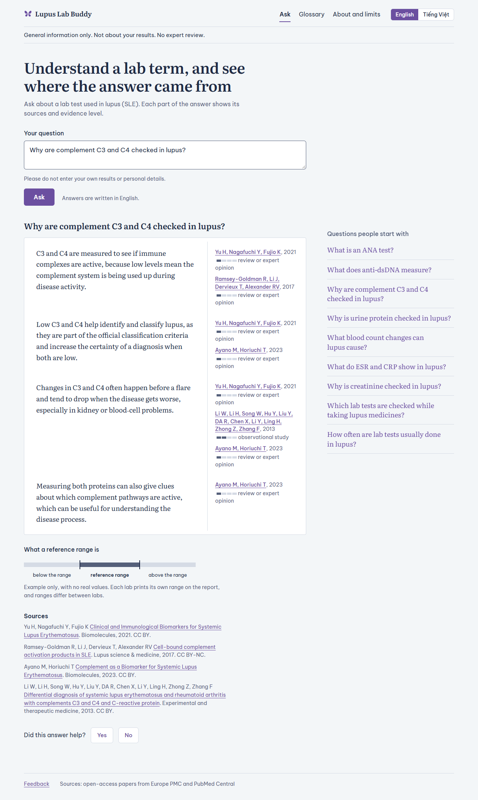
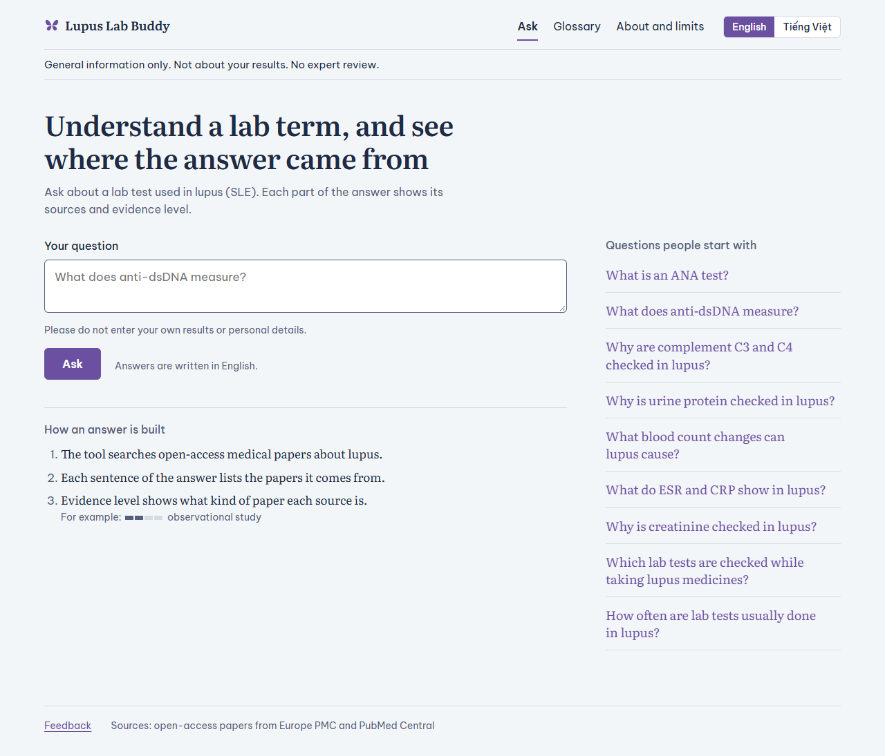
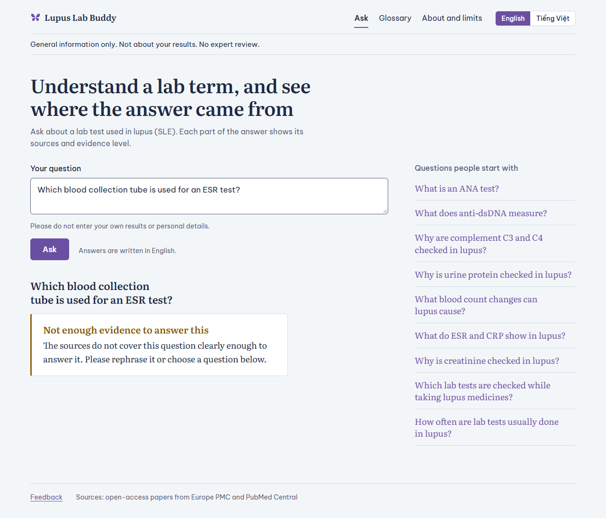
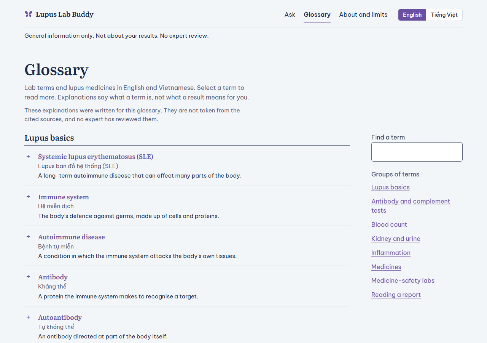
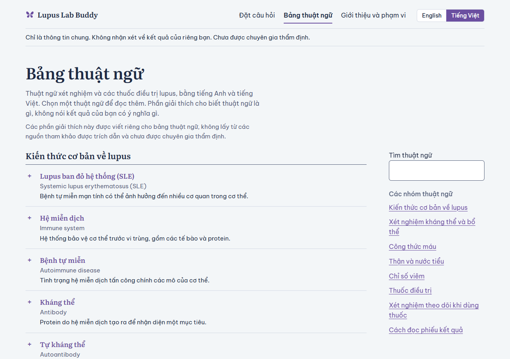
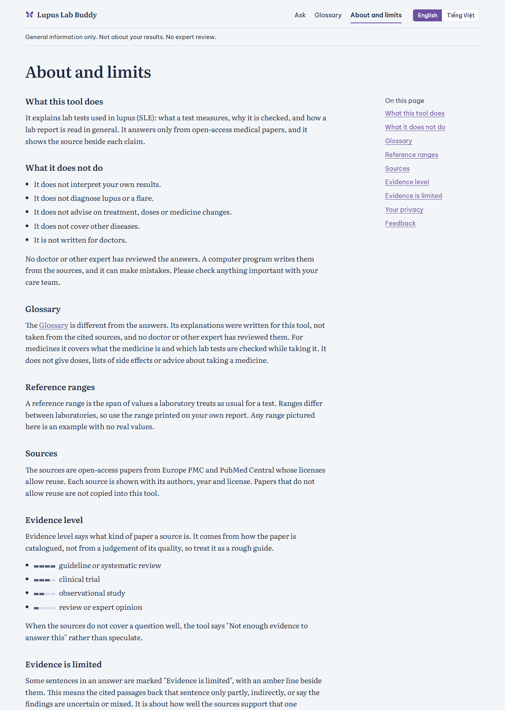
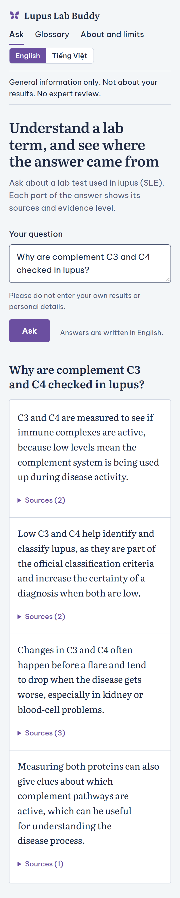

# Lupus Lab Buddy

**Live site: https://lupuslabbuddy.ngannguyen.workers.dev/**

A lab report can be hard to read. The short names and flagged numbers can be confusing, sometimes worrying, and often there is no one to ask in that moment.

Lupus Lab Buddy explains, in plain words, the lab tests used in lupus (SLE): what each test measures and why it is checked. It is for people with lupus, the family and friends who support them, and medical and nursing students learning about lupus. It is for learning and reference.



*This screenshot uses saved sample data: see [About the screenshots](#about-the-screenshots).*

## What you get

- Clear answers in short, everyday sentences.
- A source for every claim. Each sentence names the open-access medical papers it comes from, and shows what kind of paper each one is (its evidence level). Evidence level is a rough guide to the type of study, not a judgement of its quality.
- An honest "Not enough evidence to answer this" when the papers do not cover a question well, instead of a guess.
- A glossary of about 80 lab terms and lupus medicines. Each has a short definition and a fuller explanation of what it measures and why it is checked.
- English and Tiếng Việt, for the whole site and for answers.

## What this tool leaves to your care team

Your doctors and nurses know your history, your lab's ranges and your treatment. So these stay with them:

- what your own results mean, or the results of someone you care for;
- whether a result points to lupus or a flare;
- treatment, doses and any change to a medicine.

Reference ranges differ from lab to lab, so the site shows no real values. Any range pictured is only an example.

No doctor or other expert has reviewed the answers or the glossary. An AI model writes the answers from the papers, and it can make mistakes. Please ask your care team about anything important.

Good to know:

- It covers lupus only.
- Your questions are not saved. Please do not type in results or personal details.
- The site runs on a free plan with a daily limit. On some days the limit runs out, and the site cannot answer until it is back.

## A look at the site

<table>
<tr>
<td width="45%">Type a question about a lupus lab test, or pick one of the starter questions beside the box.</td>
<td></td>
</tr>
<tr>
<td>Each sentence shows its sources beside it, with the kind of paper each one is. The full list of sources sits below.</td>
<td></td>
</tr>
<tr>
<td>When the papers do not cover a question well enough, it says "Not enough evidence to answer this" rather than guess.</td>
<td></td>
</tr>
<tr>
<td>About 80 lab terms and lupus medicines, each with a short definition and a fuller explanation of what it measures and why it is checked.</td>
<td></td>
</tr>
<tr>
<td>Choose Tiếng Việt and the whole site, answers included, switches to Vietnamese.</td>
<td></td>
</tr>
<tr>
<td>About and limits says who the site is for and what it leaves to your care team.</td>
<td></td>
</tr>
<tr>
<td>On a phone, each sentence's sources fold away under it.</td>
<td></td>
</tr>
</table>

## For developers

### How it works

1. **Check the question.** Questions about a person's own results, diagnosis, treatment or other diseases are turned away. Vietnamese questions are translated to English.
2. **Find passages.** The question is turned into numbers (an embedding) and compared with about 2,600 passages from open-access papers. The 8 closest are kept, and only those above a similarity threshold count. Fewer than 2 means "Not enough evidence to answer this".
3. **Write the answer.** The AI model writes short sentences, each naming the passages it is based on.
4. **Check the citations in code.** Any sentence without a valid citation is dropped. If none survive, the app refuses. The evidence level of each paper is then added from the library, not by the model.

### Tech stack

- **Cloudflare Workers** (TypeScript): one small server that serves the pages and the `/api/ask` endpoint.
- **Workers AI**: `gpt-oss-120b` writes the answers; `bge-base-en-v1.5` makes the embeddings.
- **Cloudflare Vectorize**: the search index of passages.
- **Plain HTML, CSS and JavaScript** for the pages, with self-hosted Literata and Be Vietnam Pro fonts.
- **Node.js scripts** for collecting papers, building the index and testing.
- **GitHub Actions**: a weekly job adds new papers ([.github/workflows/refresh.yml](.github/workflows/refresh.yml)).

Which AI services are used is set in one file, [config/providers.ts](config/providers.ts).

### Run locally

You need Node.js 24 or newer and a free Cloudflare account.

1. Install and sign in to Cloudflare:

   ```sh
   npm install
   npx wrangler login
   ```

2. Create a file named `.env` in the project folder with your Cloudflare account ID and an API token that can use Workers AI and Vectorize:

   ```
   CF_ACCOUNT_ID=your-account-id
   CF_AI_TOKEN=your-api-token
   ```

   `.env` is ignored by git. Never commit it.

3. Build the library and the search index. The paper download is free; the embedding step uses Workers AI allowance (a full library uses most of a day's free allowance, so start with a sample):

   ```sh
   npm run ingest -- --limit 20
   npm run embed
   ```

   Leave out `-- --limit 20` to collect the full library.

4. Start the app and open http://localhost:8787:

   ```sh
   npm run dev
   ```

Other commands:

| Command | What it does |
|---|---|
| `npm run ask -- "What does complement C3 measure?"` | Ask one question from the command line (add `--vi` for Vietnamese, `--trace` to see each step) |
| `npm run typecheck` | Check the code for type errors |
| `npm run eval` | Run the 40 test runs in `eval/questions.json` (uses most of a day's free allowance) |
| `npm run deploy` | Publish to Cloudflare |

### Data sources and licenses

Answers come only from open-access papers found through [Europe PMC](https://europepmc.org/) and [PubMed Central](https://www.ncbi.nlm.nih.gov/pmc/). Only papers under CC0, CC BY, CC BY-SA, CC BY-NC or CC BY-NC-SA licenses are copied into the library. Papers with "no derivatives" (ND) licenses, or without an open license, are not copied.

On 17 Nov 2026 the library held 118 papers (77 CC BY, 38 CC BY-NC, 2 CC0, 1 CC BY-NC-SA), cut into 2,655 passages. For every paper the app keeps the title, authors, journal, year, PMCID, DOI, license and an attribution line, and every answer shows the authors, title, journal, year and license of each source it uses. The library files are rebuilt by the scripts above and are not stored in this repository.

Papers shown in the screenshots:

- Yu H, Nagafuchi Y, Fujio K. Clinical and Immunological Biomarkers for Systemic Lupus Erythematosus. *Biomolecules* (2021). https://doi.org/10.3390/biom11070928. CC BY.
- Ramsey-Goldman R, Li J, Dervieux T, Alexander RV. Cell-bound complement activation products in SLE. *Lupus Science & Medicine* (2017). https://doi.org/10.1136/lupus-2017-000236. CC BY-NC.
- Ayano M, Horiuchi T. Complement as a Biomarker for Systemic Lupus Erythematosus. *Biomolecules* (2023). https://doi.org/10.3390/biom13020367. CC BY.
- Li W, Li H, Song W, Hu Y, Liu Y, DA R, Chen X, Li Y, Ling H, Zhong Z, Zhang F. Differential diagnosis of systemic lupus erythematosus and rheumatoid arthritis with complements C3 and C4 and C-reactive protein. *Experimental and Therapeutic Medicine* (2013). https://doi.org/10.3892/etm.2013.1304. CC BY.

The answer sentences are short summaries generated from these papers, not quotations. The glossary explanations were written for this project and are not taken from the papers.

The project's own code does not have a license file yet.

### About the screenshots

All screenshots were taken from the app running locally on 17 Nov 2026, at 1280 pixels wide (the phone one at 360). The AI free daily allowance was used up that day, so the **answer** and **"Not enough evidence"** screenshots replay saved results from the project's test run (`eval/results.jsonl`) instead of a live question. Those saved results are real output of the same answer flow, and the papers shown are real papers in the library; the page draws them exactly as it would a live answer. The empty Ask page, Glossary and About pages use no sample data. The Ask and About screenshots show the wording from before the site was opened up to carers and students, so their headings differ slightly from the live site.
